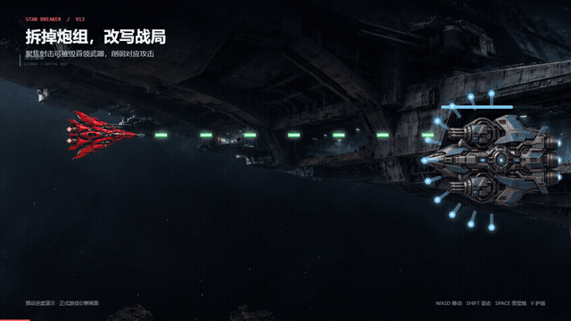

# Star Breaker · 星际突围

Shoot the guns off a boss, upgrade your fighter, and survive five sectors of deep space. Star Breaker is a single-player, side-scrolling shooter for desktop browsers.

[Play in your browser](https://star-breaker-aura-261107.huafeihua560.chatgpt.site/) · [Play on itch.io](https://aura417786.itch.io/star-breaker) · [Watch the 30-second trailer](media/trailer.mp4) · [中文说明](README.md)

[Fullscreen bug fix comparison video](media/fullscreen-compare.mp4) · [Development write-up in Chinese](promotion/全屏敌机消失复盘.md)

- **Disarm bosses.** Destroy their upper or lower gun mounts to shut down the attacks they control. Later battles pit you against two bosses at once.
- **Upgrade your main gun.** Shoot power-up orbs to fire faster, add firing lanes, or launch harder-hitting rounds. Later orbs can grant several levels at once.
- **Hold off growing enemy waves.** Ordinary fighters get tougher and arrive faster as the run goes on. After two minutes, newly spawned armored fighters can survive a single heavy hit from your main gun.
- **Evolve after boss victories.** Choose wing guns, an AI wingman, or a shield that absorbs enemy shots and fires them back.
- **Time your shield.** A perfect block gives you three seconds to trigger a faster charge for a cannon shot you already have stored.
- **Travel through five sectors.** Fly past planets, debris, and capital ships. Each galaxy casts a different tint on the Crimson Fighter's wings and canopy.

## Quick start

Use a desktop browser and keyboard. On your first visit, select **明白了** (Got it) to close the guide. Select **English** on the main menu to switch the whole game to English, then select **Start Game**. You can reopen the guide with **How to Play**. Your main gun fires automatically.

| Key | Action |
| --- | --- |
| Arrow keys or WASD | Move and aim |
| Shift | Switch between spread and focused fire |
| Space | Charge and fire a stored cannon shot |
| V | Use a stored shield charge for two seconds of protection |

After one run, I’d love to know where you first died and which moment made you want to play again. [Share playtest feedback](https://github.com/Aura417786/StarCraft/issues/new?title=Star%20Breaker%20playtest%20feedback)

## About the project

I began with movement, autofire, and scoring, then built the game through AI-assisted development and playtesting. It uses HTML, CSS, JavaScript, Canvas 2D, and browser-synthesized audio via Web Audio. The ships, bosses, and scenery use AI-generated artwork selected and integrated for the game.
