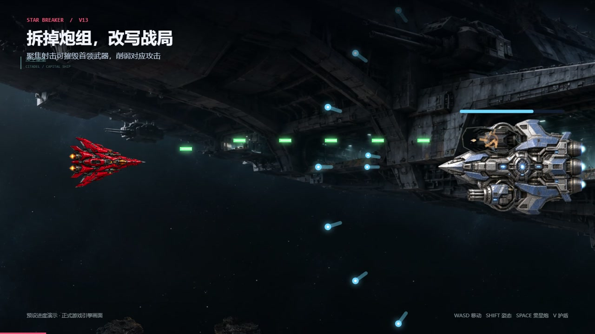
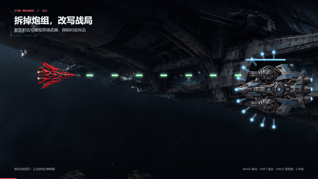

# 星际突围 · Star Breaker

**驾驶赤焰战机，穿过五片星域，迎击十只异形与最终合体。**

一款电脑浏览器横向太空射击小游戏，当前版本为 **v14「群渊战役」**。

[](https://star-breaker-aura-261107.huafeihua560.chatgpt.site/)

[▶ 在线试玩](https://star-breaker-aura-261107.huafeihua560.chatgpt.site/) · [itch.io 免费试玩](https://aura417786.itch.io/star-breaker) · [观看旧版 30 秒演示](media/trailer.mp4) · [了解游戏与制作过程](https://star-breaker-aura-261107.huafeihua560.chatgpt.site/about.html) · [English quick start](README.en.md)

切换全屏曾经会清空敌机。看同一操作在两个版本里的实机对比，了解修复后怎样保留本局战斗进度。[全屏 Bug 复盘与短片](promotion/全屏敌机消失复盘.md)

- **群渊战役。** 从渊潮母体打到无昼神经王，再挑战群渊合生体。它会先用减速牵制走位，再引爆锁定区域。
- **强化主炮，进化战机。** 射中能量球后，射击加快、弹道展开或弹体加粗。连击可以触发暴走，击败首领后可选择翼炮、僚机或壁垒。
- **迎击越来越密的敌潮。** 航程越长，普通敌机越耐打，也来得越密。后期可切换聚焦持续压制重甲机和炮击机，或用贯星炮打开航路。
- **满血也值得抢绿球。** 受伤时恢复一点生命，满血时增加一点生命上限并补满新增的一格。每局从三点开始。
- **用护盾打出反击。** 等敌弹贴近再开盾，触发完美格挡后，可以更快发射已储存的贯星炮。
- **在五片星域里贴近战斗。** 钻过陨石窄缝争夺黄球，等断舰缺口打开再开火，贴着巨舰的机库拦截编队。穿过晨昏线和黑洞时，赤焰的机翼与座舱会映出沿途的光。



## 开始一局

使用电脑浏览器和键盘打开上方的「在线试玩」。首次打开时会自动显示「玩法说明」，其中介绍按键、能量球强化、首领进化和完美护盾。日后可从主页的同名按钮重新查看。主页的 **English** 按钮会把游戏切换为英文，英文模式下可点 **Chinese** 切回。开始游戏后，主炮自动向右射击，上下移动即可瞄准。

| 按键 | 操作 |
| --- | --- |
| 方向键 / WASD | 移动与瞄准 |
| Shift | 切换扩散 / 聚焦 |
| 空格 | 消耗储能，蓄力发射贯星炮 |
| V | 消耗储能，开启两秒护盾 |

主炮已有四条弹道时，再射中黄球即可合束晋阶，获得额外 **12%** 总火力。开盾后 **0.25 秒**内挡住实体敌弹可触发完美格挡，打出反击并返还 **25%** 护盾充能。如果已经存好一发贯星炮，可在接下来 **3 秒**内按空格，将这次蓄力从 **0.85 秒**缩短到 **0.45 秒**。

试玩后欢迎告诉我第一次在哪里阵亡、最爽的瞬间，以及是什么让你想继续或退出。也可以附上结束画面的截图。[提交试玩反馈](https://github.com/Aura417786/StarCraft/issues/new?title=Star%20Breaker%20playtest%20feedback)

## 关于这份作品

这是一次从零起步的 vibe coding 实践。制作过程包括提出需求、亲自试玩和反馈，再由 AI 协助编程、排查问题与制作素材。战机、首领和背景图片由 AI 生成并整合，音效与动态配乐在浏览器本地合成。

技术采用原生 HTML、CSS、JavaScript、Canvas 2D 和 Web Audio，预渲染场景与分层视差形成 2.5D 观感。完整下载源码后，保留 `assets` 文件夹并双击 `index.html` 也能游玩。

---

## 完整规则与开发说明

# 星际突围

通过 vibe coding 逐步制作的横向飞机射击小游戏。当前版本为 v14「群渊战役」。异形首领按固定顺序出场，最终一战结束后结算通关。普通敌机编队、视差星域、掩体与运输舰穿插在首领之间。

## v13 深空远征

### 五片星域的环境遭遇

每片星域都有一段最长约 30 秒的飞行遭遇。场景继续向左移动，近处的舰体和碎岩掠过得更快，远处星系移动得更慢。主要环节预留约 22 秒，关键时刻会为场景编队或地形让出刷怪空间。Boss 预警和换景优先，收尾画面可以提早淡出。每段在一局中至多完整体验一次，如果该星域当时没有合适的空档，下一圈会更早开始寻找时机。

| 星域 | 飞行与战斗 |
| --- | --- |
| 曙光轨道 | 从行星暗面飞向晨昏线，暖光从地平线露出，扫过赤焰机翼。 |
| 碎星航道 | 巨岩之间有一颗黄球。对准缺口射击即可强化弹道，也可以走外侧宽路继续前进。 |
| 余烬墓场 | 断舰两段相对移动，中央缺口开合。借残骸挡普通敌弹，在缺口张开时调整到中间还击。 |
| 深空壁垒 | 巨舰先遮住远星，随后贴身掠过。留意发光的机库口，拦截离舰编队，或借漂出的甲板掩体挡弹。舰尾过后，星空重新展开。 |
| 虚空之眼 | 先看到远处星光弯曲与引力预警。潮汐生效时，双方普通弹道沿同一引力规则转向。 |

试玩时可以等舰体从剪影接近，留意机库、掩体和飞行编队能否对得上。换一条航路再打一次，看看射击角度和躲弹空间有什么变化。在遭遇中进出全屏或切走窗口，检查场景是否从原处继续，以及弹幕、预警和血条是否依旧容易辨认。

深空壁垒新增的独立巨舰图层由内置 imagegen 生成。[素材与完整提示词](assets/scenery/journey-citadel-prompt.txt)

### 后期伤害平衡

这次调整针对高阶弹道、暴走、聚焦射击和进化武器叠加后的爆发。红球的后期伤害倍率降到每级至少 9%，蓝球的后期攻速倍率降到每级至少 6.5%。首颗红球仍把基础伤害从 1 提到 2，首颗蓝球仍把射速从每秒 5 次提高到 6.25 次。后期强敌和首领需要连续命中，贯星炮仍适合贯穿一整条普通敌机航路。

试玩时先观察第一颗蓝球、红球和黄球的提升。进入后期后，切换聚焦对准满血重甲机和炮击机，留意首轮过后的血条。首领战先躲开标线，再在招式间隙用聚焦持续输出。

### 敌潮与武器成长平衡

前期保留原有血量，后期新出场的普通敌机耐久增长更快，出生血量按战斗时间独立计算。黄球改变弹道，红球提高伤害并让弹体更长、更粗。随战斗推进，一颗补给可以提升多级，命中时会显示本次增幅。

### 赤焰环境反光（2026-11-09）

赤焰的机翼边缘与座舱在原贴图上叠加窄幅反光。反光颜色和方向使用星域渐变的权重，侧倾时迎光一侧略微提亮。普通与进化后的赤焰共享效果。减少动态效果模式下，反光随场景缓慢换色。

### 战场背景可见性（2026-11-09）

五片星域由既有场景与星系概念图合成，保留行星、陨石、残骸、巨舰和黑洞的轮廓，用近处结构遮挡远方星光。背景缓慢左移并轻微推近，贴近镜头的碎石移动更快。背景单独压暗以便辨认弹道，主菜单沿用静谧的夜侧行星。保留 PNG 原图，游戏加载同尺寸的 WebP，并优先加载第一片星域。75 秒航程和末尾 10 秒换景渐变沿用。[素材提示词](assets/scenery/galaxy-generation-prompts.txt)

### 成长系统与新手说明（2026-11-09）

普通敌机、王牌、运输舰与 Boss 的耐久随有效战斗时间增长。敌方参考火力按固定时间进度计算，每 30 秒的参考值平滑连接。普通敌机和 Boss 分别采用独立的耐久曲线，后续 Boss 的耐久也参考同期的普通敌机。

黄色弹道晋阶获得额外 **12%** 总火力，弹体加长加粗，射击声逐阶加重。红球和蓝球随等级继续增长，高攻速用成组齐射呈现。超过每秒 200 次的攻速倍率按 0.35 次方折算成单发伤害。Boss 进化的三条路线为破阵翼刃、星隼僚机、赤金壁垒，选卡中可预览即将获得的能力。三条满级后可选双路线联动，集齐后继续领取超限整备。

### 静谧深空背景（2026-11-08）

五片星域使用新生成的 `assets/scenery/*-silent.png`：夜侧行星只露出遥远弧边，碎星与废弃舰体退到边缘，巨舰显现微弱背光轮廓，黑洞缩为深空中的细小透镜。画面以大面积幽暗虚空、稀疏微星和若隐若现的蓝紫星云表现距离；保留暗部层次，不给战机、敌弹或 HUD 加暗色滤镜。素材由内置 imagegen 生成，完整提示词在 `assets/scenery/silent-generation-prompts.txt`。

背景取景由 1.65 倍改为 1.28 倍，让远方天体有更多空间；远星约以 1.2–6.2 像素/秒左移，少量近处星尘以 10–23 像素/秒经过。近景碎片仅在陨石与舰队星域边缘出现，最多两片，透明度不超过 12%；轨道与黑洞中不安排近景石块。原有 75 秒一片星域、10 秒渐变、暂停与全屏保留进度的规则沿用。

亲自验收：开始游戏，观察行星只在下方露出夜侧弧边、微弱星云仍有纹理，主炮和敌弹清楚；飞行约 65–75 秒确认换景平滑且始终向左经过。后续巨舰应在远方边缘、黑洞应小而遥远。切走窗口和返回后背景继续原来的进度，开启系统“减少动态效果”时应保持安静的静态取景。

本次通过 71 项 v13 集成与 20 项战术集成检查，并在浏览器逐一检查五片星域的真实战斗画面；未调整武器、成长、敌人或技能数值。

### 战术玩法更新（2026-11-08）

该次更新增加王牌交锋、完美格挡连携、重力潮汐三项玩法。

**敌方王牌**最早在 36 秒开始接近，以 1.35 秒航线预警入场；会避让可见弹道，闪避约有 1.9 秒冷却。它在侧移后锁定突进航线，预警 0.9 秒再短途突进；发射两到三颗留有空隙的弹后，进入 1.4 秒冷却，绿色轮廓提示反击。突进终点保留水平安全距离，玩家进入锁定路线时会取消突进，矮窗也不安排突进。王牌出生血量固定，击毁得 800 分，最多停留约 20 秒；撤离不扣血，之后约 65 秒再接近。它与 Boss、运输舰、编队和重力潮汐错开；冲突时会延后，Boss 接近则提前撤离。

**完美连携**：完美护盾成功后获得 **3 秒有效战斗时间**的机会。期间按空格消耗已有的一发贯星炮，蓄力从 **0.85 秒缩短为 0.45 秒**，配上冰蓝小环与亮白炮芯。它只影响下一次成功释放，不改变已经开始蓄力的炮，也不增加伤害或储存次数；对每只 Boss 的单次 18% 上限保持。普通暂停和隐藏冻结窗口，新局、死亡、菜单、Boss 解体和选卡会清除；取消未发炮仍按原规则退款，已经消费的连携不会退还。

**重力潮汐**：在「虚空之眼」完整进入后，普通战斗中先等待约 3 秒，再以 **2.4 秒预警 → 6 秒生效 → 12 秒间歇**循环。紫色区域内，双方普通子弹逐渐向核心弯曲；子弹速度和伤害不变，最大偏转约 17 度，水平飞行方向不会倒转。战机、增益球、贯星炮以及 Boss 光束/雷区不受影响。Boss 预警、王牌、编队、运输舰、换景和可飞区域过小时会暂停安排潮汐；中止时清除已被弯曲的敌弹，保留敌机与血量。调整窗口后重新完整预警，切走窗口时冻结计时。

亲自验收：

1. 飞行约 36 秒以后留意「敌方王牌接近」，观察橙色锁线与开火后的绿色冷却轮廓，用 Shift 聚焦追打。特殊事件可能使入场延后。
2. 存好一发贯星炮，在敌弹靠近时按 V；看到「完美连携」后 3 秒内按空格，应更快发射，储存次数仍只减少一发。提前开盾而未完美格挡时仍按 0.85 秒蓄力。
3. 持续生存约 5 分钟进入黑洞星域，等无 Boss 或其他特殊遭遇时观察紫色预警，比较黄/绿等主炮与粉色敌弹的弯曲。普通星域恢复正常直线/扩散射击。
4. 暂停、全屏往返和重开，确认不会重复获得王牌击杀奖励或连携机会，重开时所有新状态归零。

自动检查：**297 项战斗 + 71 项 v13 集成 + 66 项音频 + 20 项战术集成，共 454 项**。新增战术检查运行 `node work/tactics-check.cjs`，覆盖真实帧的双向弯曲、王牌锁线/空档/一次结算、事件互斥、暂停与尺寸适配。

### 未来科幻舰体（2026-11-08）

按玩家选定的「未来科幻」方向重绘红色战机、突击机、重甲机与炮击机：大块连续涂装、流线曲面、完整深色玻璃座舱，发光集中在双引擎与少量识别灯。移除密集划痕、铆钉、亮银描边和破碎机械纹理。当前使用 `assets/ships/*-sleek.png` 六张透明素材，包括独立的流线护甲与封闭式轨道炮配件，由内置 imagegen 生成；完整提示词在 `sleek-generation-prompts.txt`。原有首领舰体继续使用。运行时仍使用 Canvas 2D 与 2.5D 合成。

`ship-renderer.js` 负责舰体、短而克制的冰蓝喷流、侧倾与受击闪光。素材按原始宽高比等比放进绘制边界，不再被拉伸；以真实机鼻为变换支点，弹道中轴始终对齐。玩家与敌机的尺寸、血量、伤害和碰撞规则沿用现有玩法。切走窗口和进化选卡时视觉时钟随战斗暂停；减少动态效果时使用稳定的舰体与尾焰。

进化配件采用同一套流线涂装：翼刃向外展开，轨道炮贴合机身，护甲舱加宽肩部；等级与混合进化沿用现有规则。船体只缓存一张原色图，取消额外的平面染色层与整机提亮；每种素材最多六种尺寸，高清画布最多按两倍像素密度准备。全屏往返保留敌人和血量，原有程序绘制保留作兼容路径。

验收以原有游戏尺寸进行：红色玩家机与青色突击机、珍珠钛色重甲机、白紫色炮击机的轮廓应清楚。上下移动检查机鼻与弹道对齐；三路线与满级混合进化不应出现旧机械配件。全屏进出后敌机、血量与进度保留。原有 **297 项战斗、71 项集成、66 项音频检查**继续回归。

### 持续前进的五片星域

背景随着有效飞行时间持续向左移动，表现战机向右前进。远景、星点与近处尘埃以不同速度移动；素材使用重新生成的原创科幻场景图，参考科幻大作的真实材质、尺度和光影方向。它采用预渲染素材与多层视差的 2.5D 表现，不是完整 3D 引擎或实时光线追踪。

依次经过「曙光轨道 → 碎星航道 → 余烬墓场 → 深空壁垒 → 虚空之眼」，然后继续循环。每片星域飞行 **75 秒**，最后 **10 秒**平滑渐变到下一片；全程向左平移，不需要击败 Boss。暂停、进化选择及解体演出时，场景时间也冻结。窗口缩放保留飞行进度，重开从轨道开始。系统的“减少动态效果”设置会压低运动效果。

### 会配合的小怪

最早在 24 秒出现第一波编队，提前 1.35 秒显示航线预警。三种编队轮换：重甲前卫护航、金色指挥机带领的楔形队、上下包抄。击毁队长会使队员失序减速 1.5 秒，并中止尚未发出的炮击；上下包抄保留中央通道，窄矮窗口空间不足时延后生成。

编队替代相应数量的普通刷新，不额外叠加一倍敌潮；保持最多 14 架普通敌机、最多 2 架炮击机。首领预警及首领战清场，运输舰事件与编队不同时启动。

### 利用物件与截获运输舰

- **能源罐**：最早 16 秒出现，随后物件约每 18 秒一次，场上最多 3 个。射爆能源罐可清除半径内的实体敌弹，并炸伤小怪；不伤玩家，不直接奖励分数、连击或大招能量。爆炸真正击毁敌机时仍正常计分。
- **漂浮残骸**：阻挡主炮和普通实体敌弹，承受射击后会破碎；不会挡激光和范围攻击。物件本身不产生机身碰撞伤害。大招可以击碎物件并继续贯穿。
- **补给运输舰**：最早 52 秒尝试出现，若遇到编队或首领会延后。带两架护航机，击毁得 600 分并掉落蓝、黄、红补给（遵守场上补给上限）；逃走不扣血，碰撞移除不会发奖励。后续尝试间隔 76 秒。

### 亲自验收

1. 开局观察固定的行星地形和星点：它们应持续向左经过；暂停后应停止，恢复后继续。
2. 飞行约 65 秒开始看到轨道逐渐变为陨石带，约 75 秒完成；转换期间仍能看清敌机、弹幕和血条。之后每 75 秒更换一片星域。
3. 24 秒后留意编队预警，击毁金色队长，观察队员散开减速；也可使用 Shift 聚焦先拆前卫。
4. 射爆能源罐，观察附近敌弹消失；躲在残骸左侧看它挡弹，再把残骸打碎。
5. 拦截运输舰并射击掉落补给；下一次放它飞过去，确认不会扣血。
6. 约 75 秒遇到渊潮母体。对准身体持续输出，注意它的触须先收卷再甩出。打至半血，观察外壳张开和三次分段扫击。
7. 在敌机仍存活时连续进入、退出全屏，确认敌机和剩余血量保留，编队、运输舰、补给与本局进度也不重置；缩小窗口后应有短暂受伤保护，包抄编队中央仍留有通道。调整窗口时确认首领血量、位置和预警保持连贯。最后重开，确认场景、编队、物件、分数与成长才会重置。

**71 项 v13 集成检查**通过，覆盖时间换景、左移连续性、图片缓存、编队、部件、掩体、运输舰，以及全屏往返时的实体、血量、进度保留和窄窗保护：`node work/v13-check.cjs`。原有 **297 项战斗检查、66 项音频检查**继续通过。自动检查不代替实际画面与手感验收。

## 打开与操作

直接双击 `index.html`，用电脑浏览器打开，不需要安装游戏依赖。请保留完整的 `assets` 文件夹。已经打开游戏时，按 Ctrl + F5 刷新以加载修改。

- 方向键或 WASD：按屏幕方向移动，松开停止；自动向右射击。
- Shift：切换扩散／聚焦射击；也可以点击右下方的姿态按钮。切换不消耗资源。
- 空格：消耗 1 次大招，蓄力 0.85 秒后自动发射；按一下即可，不必按住。
- V：消耗 1 次护盾，获得 2 秒无敌；初始每 25 秒有效战斗时间充好 1 次，壁垒进化后缩短为 20 / 17 / 14 秒，最多储存 2 次。
- 首领战结束后的进化界面：点击卡片，或按 1 / 2 / 3 选择；也可用 Tab 切换、Enter 确认。选择期间暂停战斗，Esc 不会跳过奖励。
- 右上角“全屏”：进入全屏；按 Esc 或点击“退出全屏”恢复。
- 点击战场：恢复键盘控制。切换窗口、标签页或按 Tab 离开战场后，战斗暂停。
- 震动按钮：在关闭、轻微、较强之间切换并记住本机选择；系统开启减少动态效果时始终关闭震动。
- 声音按钮：切换静音；浏览器会记住本机的选择。声音在第一次点击开始游戏后启用。
- “重新开始”：清空本局进度，重新出发。

## 当前规则

| 内容 | 规则 |
| --- | --- |
| 玩家生命 | 每局从 3 点开始；碰到普通敌机，或被炮击机炮弹、Boss 攻击命中，扣 1 点 |
| 敌机飞过 | 不扣血，敌机继续向左飞，离开屏幕后清理 |
| 接触敌机 | 机身实际碰撞才扣血；透明图片边缘不算，碰撞移除敌机但不计分、击杀或充能 |
| 受伤保护 | 小怪碰撞、炮击机炮弹和 Boss 攻击共享 1.1 秒保护，多架同帧碰撞不会瞬间扣光生命 |
| 初始武器 | 每秒发射 5 次，1 阶黄色子弹、1 条弹道，每颗子弹造成 1 点伤害 |
| 敌机生成 | 初始约每 1.2 秒一架，随时间逐步接近每 0.42 秒一架。Boss 预警及战斗期间暂停普通刷怪 |
| 敌机速度 | 随有效战斗时间持续上升，每架再有少量随机变化 |
| 击毁得分 | 突击机 +100、重甲机 +200、炮击机 +150 分；召唤护卫仍为 +100；漏过不加分、不计入击毁数 |
| 游戏结束 | 生命归零则失败，击败最终合体则通关，两者都显示分数、时间和击毁数 |
| 调整窗口或切换全屏 | 保留现有敌机及血量、编队、运输舰、能量球、战场物件和本局进度，按新尺寸适配位置；尺寸确实改变时给予至少 1.1 秒受伤保护并清理旧弹道及瞬时特效，在场 Boss 保留血量和破损部件，重新预警后才攻击 |
| 重新开始 | 恢复初始武器、3 点生命、0 分、0 击毁、00:00 和初始难度，清空全部进化，同时重置 Boss 出场计时并从渊潮母体开始 |

上下移动用于瞄准和躲开敌机，也用于离开炮击机的预警射线；允许敌机从旁边飞过。敌机越来越快，主动向右飞时同样要注意相撞。

### 三种普通敌机

| 敌机 | 外形与首次加入时间 | 行为与应对 | 同期血量 / 速度倍率 | 击毁得分 |
| --- | --- | --- | --- | --- |
| 突击机 | 青蓝尖翼，开局就有 | 速度快、上下波浪飞行；第一架居中直飞，方便瞄准 | 1 / 1.22 | 100 |
| 重甲机 | 铜色宽肩装甲，18 秒后加入 | 厚血、慢速直飞，可持续瞄准或用贯星炮贯穿 | 2.8 / 0.65 | 200 |
| 炮击机 | 紫色双翼炮管，40 秒后加入 | 飞到右侧停下，锁定玩家位置，预警后发射；共开两炮，随后向左撤离 | 1.5 / 0.8 | 150 |

表中时间是开始生成该类型的门槛，具体入场还取决于刷怪间隔。新类型解锁后优先生成一次。18–40 秒期间按 65% 突击、35% 重甲混合，40 秒后常规按 50% / 30% / 20% 抽取。最多同时存在两架炮击机，达到上限时将新抽到的炮击机改为突击机。三种敌机共享同一出场节奏和在场上限。

炮击机发射前有 **0.9 秒粉红虚线与炮口亮光预警**，线上的圆圈表示当时锁定的位置。锁定后不再追踪玩家；看到预警后转向即可躲避，预警线本身不造成伤害。真正的攻击是沿线飞行的粉红短炮弹，每颗命中扣 1 点生命。两次攻击间隔至少 0.65 秒恢复加下一次预警；贴近炮击机或绕到其身后时，它会撤离，不突然掉头射击。

射击击毁炮击机可中断尚未发出的攻击，已经发出的炮弹仍需躲避或开盾。护盾与 1.1 秒受伤保护同样抵挡这些炮弹。Boss 预警及出场会清理普通敌机和炮弹；Boss 召唤护卫继续沿用原来的银灰外形与攻击规则。

### 敌机持续变强

开局突击机一击即可击毁。普通敌机的血量随有效战斗时间增长，后期耐久增长更快。血量按独立的时间曲线计算，每架敌机出生时确定血量。

从 1 分 25 秒起，新出场的强敌会压低过高的普通弹伤害。单次普通命中最多按目标满血的一部分结算。突击机为 72%，炮击机为 58%，重甲机为 44%，王牌与运输舰为 36%。同一轮集中火力也有短暂的累计承伤限制。贯星炮仍可贯穿并击毁同一直线上的普通敌机。

战斗持续越久，普通敌机出场间隔越短。下表是普通战斗段、在场名额充足时的近似刷新频率。编队占用普通刷怪名额，Boss 预警和交战期间暂停普通刷新。

| 有效战斗时间 | 开局 | 2 分钟 | 5 分钟 | 10 分钟 |
| --- | --- | --- | --- | --- |
| 普通敌机刷新频率 | 0.83 架/秒 | 1.24 架/秒 | 1.81 架/秒 | 2.26 架/秒 |

血条是一整条圆角色带，受伤后平滑缩短。没有分段、刻度、数字、HP 字样或其他标识。颜色随剩余血量由青色变成黄色、红色。

## 连击与暴走

击毁一架敌机或一只 Boss 增加 **1 连击**。主炮、进化武器和贯星炮的击杀都算。右侧面板显示当前连击、最高连击和下一次暴走进度，结算页也保留本局最高连击。

连续 **4 秒**没击杀后，连击开始每 **0.65 秒**减少 1，首次减少发生在 4.65 秒；再次击杀会重新开始这个倒计时。Boss 出场预警和整个首领战期间冻结连击衰减，方便专心躲避；切走页面或选择进化时，所有相关计时都暂停。窗口大小变化保留连击和暴走时间，重开清零。

每条连击链首次到达 **10、20、30……** 会奖励一颗增益球，按蓝、黄、红循环。球仍从右向左飞，需要普通子弹击中才能领取。连击掉下去后再次跨过同一档，不会反复发奖；归零后重新开始一条链。为避免大量瞬间击杀塞满屏幕，奖励最多暂存 3 颗，按至少 0.8 秒间隔放出，且遵守场上 7 颗补给球的生成上限；Boss 本身的固定掉落继续保留。

达到 **20 连击**自动进入 **8 秒暴走**：普通射速变为原来的 **1.6 倍**，子弹增粗、双引擎尾焰延长，启动和射击都有更厚重的声音。期间每次击杀延长 **0.35 秒**，单轮总时长最多 **14 秒**。暴走结束时，以下一档增加 20 连击作为新目标，面板会显示还差多少；连击归零后重新以 20 为目标。暂时加速不改武器永久等级，也不会使新敌机或 Boss 因这次临时加速而额外增加血量。

暴走计时在 Boss 战中继续，选择进化和切出页面才会冻结。暴走不提供无敌、不改变大招威力；大招蓄力与发射时仍暂停普通射击。暴走结束后，已经飞出的粗子弹保留自己的形状与伤害，下一发恢复普通外观。

## 扩散与聚焦射击

按一下 **Shift** 切换，也可点姿态按钮，点击后键盘控制回到战场。长按不连续切换；切换不清掉正在飞行的子弹，也不会额外补发一轮。进化选择、菜单或游戏结束时不能切换。

| 姿态 | 射击方式 | 适合情况 |
| --- | --- | --- |
| 扩散（默认） | 按已有弹道条数向上下对称展开，飞得越远覆盖越宽 | 拦截不同高度的小怪、收集补给 |
| 聚焦 | 将已有弹道合并为机头正前方一束，每发伤害乘以原弹道条数 | 集中打重甲机、首领 |

例如武器为 4 条弹道、每条 10 点伤害时，扩散一轮为 4 发各 10 点，聚焦一轮为 1 发 40 点，总火力都是 40 点。开局只有 1 条弹道时两种模式表现接近，获得黄球后差别更明显。聚焦不会把黄球等级清零；上方黄栏继续显示底层弹道等级，红栏显示当前姿态每发伤害，蓝栏在暴走时显示加速后的射速。

两种姿态都以机头为对称轴，沿用四弹道晋级、阶数颜色和进化穿透。扩散斜向子弹使用二维路径检测。切换姿态时，同一轮主炮的总伤害守恒。

## 四色增益球

能量球从右向左飞行。用子弹打中一次就能领取效果，强化会在命中时提示并体现在接下来的射击中。能量球靠射击激活，碰到或放过都不扣生命。能量球不计入分数与击毁数。

| 能量球 | 效果 |
| --- | --- |
| 蓝色「攻速」 | 第一级使射速从每秒 5 次提高到 6.25 次。后续每级至少增加 6.5% |
| 黄色「弹道」 | 增加弹道条数；超过 4 条时晋级，回到 1 条更强的弹道 |
| 红色「伤害」 | 第一级使基础伤害从 1 点提高到 2 点。后续每级至少增加 9%，再乘弹道阶数倍率 |
| 绿色「生命」♥ | 恢复 1 点生命；满血时增加 1 点生命上限与当前生命，无设计上限 |

蓝、黄、红三项独立叠加，都没有等级上限；每颗绿球提升 1 点生命，满血时同步提高上限；大招次数只靠攻击积能获得。能量球需要射击才触发；随着战斗时间增加，每颗球提供的提升也变大：

| 击中球时的战斗时间 | 蓝球增加攻速等级／红球增加基础伤害 | 黄球增加弹道条数 |
| --- | --- | --- |
| 00:00–02:59 | +1 | +1 |
| 03:00–05:59 | +2 | +1 |
| 06:00–08:59 | +3 | +2 |
| 09:00–11:59 | +4 | +2 |
| 之后 | 每过 3 分钟再多 +1，无上限 | 每过 6 分钟再多 +1，无上限 |

例如 03:35 时打中一颗红球，本次收益为两档。若基础伤害为 2 点，则增加到 4 点。处于 2 阶时，单发面板伤害从 8.96 点变成 17.92 点。多档收益比较本次固定加值与整批比例增长，取收益较高的一种。增益使用击中时的有效战斗时间。

第一颗蓝球约在 3 秒时生成，之后每 7 秒一颗。首颗之后随机选择：蓝、黄、红各 31%，绿色生命球 7%；每次独立抽取，因此不保证固定顺序。球沿不同高度的固定航线向左飞，不追踪玩家。上方黄色栏显示「N 阶 · M/4 条」，红色栏显示当前单发的面板伤害，攻速栏显示当前攻速。目标实际扣血还会受到护甲与短时承伤限制影响。命中球时显示本次增加的数值。特别大的数值用科学记数法显示，例如 `1.23×10^8` 表示约 1.23 亿。

### 对称弹道与晋级

扩散姿态以战机最右端的机头为中间轴，弹道等间隔向上下展开并对称倾斜；聚焦姿态合并到中间轴。奇数条弹道有一条正对机头；偶数条弹道的中间两条分别位于机头上方、下方，距离相同。增加弹道或移动战机时，新发射的弹道仍保持对称。

每阶有 1 到 4 条弹道。4 条时再增加 1 条便晋升下一阶，恢复为 1 条。新弹道获得原四条弹道的总火力，再提高 12%。每阶单发伤害因此是上一阶的 4.48 倍。

| 晋级前 | 获得强化 | 晋级后 |
| --- | --- | --- |
| 1 阶、3 条，每颗 1 点 | 弹道 +1 | 1 阶、4 条，每颗仍为 1 点 |
| 1 阶、4 条，每颗 1 点 | 弹道 +1 | 2 阶、1 条，每颗 4.48 点 |
| 1 阶、4 条，每颗 1 点 | 弹道 +2 | 2 阶、2 条，每颗 4.48 点 |
| 1 阶、3 条，每颗 1 点 | 弹道 +2 | 2 阶、1 条，每颗 4.48 点 |

后期一颗黄色球可能增加很多条弹道，会逐次处理晋级并保留剩余增益。弹道阶数持续成长，每晋一级，单条弹道的出膛伤害乘以 4.48。

子弹颜色按以下顺序随阶数变化；其中第 2 阶和第 4 阶都使用绿色：

| 弹道阶数 | 子弹颜色 |
| --- | --- |
| 1 | 黄色 |
| 2 | 绿色 |
| 3 | 紫色 |
| 4 | 绿色 |
| 5 | 蓝色 |
| 6 | 红色 |
| 7 及以后 | 从黄色重新循环，每 6 阶重复一次 |

晋级或获得红球，只影响之后发射的子弹。已经飞出去的子弹保留发射时的颜色和伤害，所以晋级的一瞬间可能同时看到新旧两种颜色。

攻速等级达到 8 且实际发射间隔足够短时，若干次发射会合并为一批，形成三段一组的齐射。攻速继续提高时，齐射间的间隔也会逐渐缩短。组间累积的伤害进入下一次可见发射。

受伤保留强化；重新开始或返回首页会恢复初始武器。

## 赤焰贯星炮

左下角的细条显示下一发的积能进度，五个亮格表示储存的大招次数。普通射击实际打掉敌方血量时积能：累计打掉一架小怪的完整血量共提供 12 点，Boss 完整血量共提供 180 点；100 点换 1 发，不足部分继续保留。过量伤害不多给能量，打空、射击增益球和碰撞都不积能。达到 5 发时停止积能，不暗中囤第 6 发。

按一下空格，消耗 1 发并蓄力 **0.85 秒**。机头聚集红光，响起逐渐升高的蓄力音；蓄力时仍能移动瞄准，速度为平时的 65%。蓄力结束，从当时的机头向右射出红色圆柱能量炮，伴随低沉的发射音。发射后航线固定，能贯穿同一直线的多架敌机，每个目标一炮只结算一次；普通自动射击在蓄力与发射时暂时停止，炮弹完全飞出屏幕的当帧即可再按空格开始下一次蓄力，没有额外后摇或冷却。长按不会自动连放。

伤害同时参考当前全部弹道火力和有效战斗时间，时间加成缓慢增长；最低威力可击破同阶段新生的重甲机，便于清除同一直线上的厚甲目标。对 Boss 每炮最多削去其满血的 **18%**，弱于该值时按实际威力结算。因此提前储存、瞄准并选择时机依然有意义；大招造成的伤害不为下一炮积能，也不会清除 Boss 弹幕或让玩家无敌。

切换窗口会冻结蓄力与炮弹并停止声音，回来后继续；缩放时尚未发射的蓄力取消并退回 1 发，已发射则不退款。重开和返回菜单清空全部次数与能量。生命球和普通升级一样，需要被普通子弹打中才会获得；大招会穿过增益球。

## 赤焰护盾

护盾与贯星炮分别充能。护盾无需命中敌人，初始每 **25 秒有效战斗时间**获得 1 次，壁垒进化 1 / 2 / 3 级后分别缩短到 **20 / 17 / 14 秒**，最多 **2 次**；满额后停止积累，不暗中存第 3 次。左下方护盾面板显示两格储存次数和下一次充能进度。

按 **V** 消耗 1 次，红色透明椭球包裹战机，持续 **2 秒无敌**，抵挡普通敌机碰撞、炮击机炮弹、Boss 弹幕、光束和雷区伤害；期间仍能移动、射击或释放大招。护盾开启期间不能重复消耗或叠加时长，长按也不会自动连放；结束后可再按 V 使用下一次。护盾挡住的碰撞不会给分或为大招积能。

护盾开启时仍继续充能。切换窗口会冻结持续时间与充能，恢复后继续；调整窗口保留护盾状态并让椭球继续包裹战机。重开或回到菜单清空护盾；战机死亡时护盾结束。

### 完美护盾

在实体敌弹即将碰到护盾时按 **V**：开盾后最初 **0.25 秒**内成功拦截，触发一次「完美格挡」。每次开盾最多触发一次；只开盾而没有拦到弹不会获得奖励。碰撞敌机、光束、雷区与已有受伤保护不触发完美，原本的两秒无敌仍有效。

成功后出现红色冲击环、前向反击弧、金属格挡音与 **0.16 秒、40% 速度**的短慢镜头；所有战斗系统共用相同模拟速度，暂停时冻结，减少动态效果时关闭慢镜头。返还当前护盾充能周期的 **25%**，可充好下一次，但最多储存两次，满额不保留隐藏进度。

反击覆盖屏幕内前方横带，半高为 `max(95, 战机高度 × 1.1)`，相当于基础完整主炮 **0.65 秒**的火力；每只 Boss 单次最多损失 **3%** 最大血量，且不会为大招积能或触发爆破连锁。壁垒进化原有金色反击照常生效：开盾时先检查实际接触弹，再清除附近弹，不会把整个清弹范围都算成完美格挡。调整窗口保留完美窗口和已触发标记，只清除瞬时演出；全屏往返不能重新领取奖励。

验收：充好一次护盾，等炮击机或 Boss 的实体弹靠近再按 V，应看到「完美格挡」、红色反击与充能条增加约四分之一；提前超过 0.25 秒开盾再挡弹，只应有普通无敌。连续挡住多颗弹不应重复返能；用碰撞、激光、雷区测试，仍无敌但没有完美奖励。重开后储能和完美状态归零。

## 战机进化

击败前十只异形中的任意一只，会先播放 **1.25 秒解体演出**，再打开三选一界面。最终首领解体后进入通关结算。演出期间战斗时间、危险攻击和技能计时暂停，切走窗口也暂停解体，回来继续。选择时，战斗时间、敌人、护盾充能和危险预警都不继续推进；原有敌弹清除，尚未发射的大招蓄力取消并退回次数，已经发射的炮弹结束且不退款。选择完成后，键盘控制自动回到战机，并提供 1.5 秒续战保护。

三条路线可以跨战斗混搭，效果叠加；每次选择对应路线提升 1 级，每条最多 3 级。某条路线满级后，它的卡片会禁用，仍可选择其他未满路线。它们不替代能量球：蓝、黄、红球仍负责基础攻速、弹道和伤害成长。

| 进化路线 | 1 / 2 / 3 级效果 | 外形变化 |
| --- | --- | --- |
| 破阵翼刃 | 1 级展开双翼副炮。2 级加入周期蓄能穿甲重射。3 级缩短重射间隔并增加穿透。主炮提高 25% / 45% / 65%，可额外穿透 1 / 2 / 3 个目标 | 青白翼炮逐级展开，炮口与实际射击位置对应 |
| 星隼僚机 | 1 级一架僚机自动瞄准。2 级两架协同拦截。3 级每第三轮同时发射三连齐射 | 红色流线僚机在主机上下侧伴飞 |
| 赤金壁垒 | 每次升级获得 1 次护盾，充能缩短至 20 / 17 / 14 秒。开盾清弹并反击，实际触盾时可存储 3 / 5 / 8 颗实体弹，在护盾结束后齐射 | 红金装甲逐级增厚，吸收弹沿盾缘显示 |

各路线可混搭，外形随等级变化。左下方显示路线和等级，选卡可以观看下一档攻击预览。已经飞出的子弹保留发射时的伤害。辅助武器使用同一套弹道碰撞和击杀结算，能打击敌机与首领。能量球由主炮射击领取。

双翼重射先蓄能 0.48 秒，进入 3.4 / 2.8 秒的下一轮间隔。星隼瞄准前方可见目标，发射后沿当前方向飞行。两类辅助弹与主炮共享战场和重力潮汐。

壁垒开盾获得 2 秒无敌，清除半径 **180 / 230 / 280** 内的实体敌弹，并发出前方金色反击波。反击波每次对单只首领的伤害上限为 **3% / 4% / 5%**。实际撞上护盾的实体弹才计入吸收，蓄存的反击弹可在盾结束后发射。完美格挡和贯星炮连携也可在同一次开盾中触发。护盾反击弹不积攒贯星炮能量。

三条路线全部达到 3 级后，每次胜利可选一项还未获得的联动。**锋隼联动**给僚机弹 15% 增伤与额外穿透。**隼盾联动**令开盾后的 2.4 秒进入集中齐射。**锋盾联动**把吸收反击变成增伤 50%、额外穿透两次的穿甲矛。

集齐三个联动后，可继续领取超限整备。火力整备令辅助武器伤害乘以 1.08。战地修复或护盾整备增加 1 点生命或 1 次护盾，并将辅助伤害乘以 1.04，对应资源满额时该选项不可选。超限整备可继续叠加。重新开始或返回首页会清空本局进化。

## 十一场异形战

第一场在有效战斗时间 **01:15** 开始，提前 **5 秒**预警。击败一只后，下一只相隔 **35 秒**，往后缩短到 **21 秒**。解体、选进化和暂停时，战斗计时冻结。首领战期间普通敌机停止刷新，增益球仍会出现。击败前十只分别获得 2000 分、一次进化、三色补给，并在受伤时恢复一点生命。最终合体值 6000 分，击败后结算通关。

| 顺序 | 异形 | 要留意的招式 |
| --- | --- | --- |
| 01 | 渊潮母体 | 触须扫潮、弧形潮刃、幼体孵化 |
| 02 | 骨冠猎兽 | 骨矛、肋骨弹墙、俯冲 |
| 03 | 灼核吞星兽 | 熔岩、分裂火核、炉心灼线 |
| 04 | 裂隙织母 | 交错丝刃、蛛网束缚 |
| 05 | 锁脉巨螯 | 螯击、局部束缚、棘刺 |
| 06 | 星尘镜魟 | 棱镜射线、镜刃、折返弹 |
| 07 | 沉渊震鳗 | 脉冲、潮流、追瞄连击 |
| 08 | 裂梦孢皇 | 追踪孢子、孢场、孢群散射 |
| 09 | 维度噬口 | 缺口封锁、撕裂雷区、碎片 |
| 10 | 无昼神经王 | 神经弹墙、脉冲、定点爆裂 |
| 11 | 群渊合生体 | 牵制接爆炸、共享安全通道的光束夹击、孢子诱导接棱镜伏击 |

渊潮母体平时随心跳缓慢鼓胀和收缩，出手时有收卷、前探、回弹。半血时背壳张开、心脏外露，触须由一击变为三次先后落下的攻击，潮刃和孵化也会加强。维度噬口的躯干由头至尾逐节蠕动，口器会单独开合。其他异形各有对应的鳍、外骨骼或孢囊动作，也会在右侧上下前后移动。半血后，它们会缩短招式间隔或增强攻势。

合体首领的第一套连招先在落点形成减速区，短延迟后引爆该位置。预警出来就主动移动，离开减速范围或用护盾挡下命中。第二套连招有同一条青色安全通道，光束与弹墙都围绕这条通道展开。第三套连招先逼玩家离开孢群，再用折返弹和定点爆裂追击。

首领耐久按有效战斗时间和关卡决定，出场后固定。普通火力共享短时间承伤额度，每发最多扣除 5% 最大生命，贯星炮每发最多 18%。后段首领的耐久、攻击强度与衔接速度逐步提高。命中玩家后仍有短暂保护，护盾有效。视觉素材与制作参考见 [异形素材说明](assets/aliens/README.md)。

## 声音

普通战斗使用 **98 BPM** 的低音动机、错拍鼓和金属回声。首领战提高到 **126 BPM**，狂暴阶段提高到 **146 BPM** 并加入双击和不协和应答。连击和暴走会在当前音乐上增加节奏层。

渊潮母体收卷时有渐强的低吼，甩鞭时有破空声和重击，孵化有分层的有机脉冲。重招与变形时会短暂压低音乐，让招式清楚可辨。点击开始后浏览器启用合成音频，静音按钮同时控制音乐与音效。切走窗口、结算或选进化时，战斗音乐会暂停。

## 本版重点体验

1. 击破首领：观察熄火、分段爆炸、残骸分离，再进入选择；期间不受伤、计时不增加。
2. 选翼刃，观察两侧炮口独立射击。升到 2 级后留意翼炮蓄能和穿甲重射。
3. 选星隼，观察一架伴飞僚机自动攻击。升到 2 级展开双机，3 级出现协同齐射。
4. 选壁垒，按 V 开盾迎击实体弹。观察盾上蓄存的金色弹点，以及护盾结束后的反击齐射。
5. 命中重甲机时观察局部火花，击毁后观察装甲碎片；贯星炮命中 Boss 时有红色冲击波。右上按钮可关闭或调节震动。
6. 开声音开始一局：普通战斗有旋律；连击高时鼓点增加，暴走时节奏增强，预警和 Boss 战切换音乐。切走窗口应静音。

## 亲自验收这一版

以下步骤不需要输入开发代码：

1. **切换姿态：**开局先击中黄球，让弹道变为 2 条以上。按 Shift，扩散弹应合并到机头中心，再按一次恢复对称扩散；长按不会反复跳变。观察黄栏等级不变、红栏每发伤害随姿态正确换算。
2. **保持连击：**连续击毁敌机，右侧连击逐次增加；射击能量球或放过敌机不会直接增加连击。停止击杀约 4.65 秒后应开始逐个减少，受伤不立即清零。
3. **领取连击补给：**达到 10 连击，观察右侧增加一颗蓝色补给球；射击才能升级。之后 20、30 连击分别奖励黄、红球。原来每 7 秒的常规补给继续存在。
4. **触发暴走：**到达 20 连击，应听到启动音，尾焰变长、子弹变粗，面板出现 8 秒倒计时，蓝栏射速为原来的 1.6 倍。两种姿态都能使用暴走。
5. **延长与结束：**暴走期间继续击杀，倒计时应增加；单轮最长 14 秒，不能无限延长。结束后射速和新子弹恢复，面板显示下一次暴走所需连击；大招威力和永久武器等级没有因暴走而改写。
6. **兼容技能：**暴走时按 V 应正常开盾，按空格仍需消耗一次大招并蓄力，期间普通射击停止；大招击杀仍增加连击。
7. **Boss 保护：**等待首领预警及入场，连击面板应显示“连击保护”，长时间不击杀也不衰减；已开始的暴走仍会结束。击败首领后弹出进化选择，连击、暴走和战斗时间全部冻结，选择后恢复。
8. **暂停与保存本局状态：**暴走时切换标签页再回来，倒计时不应被偷走；缩放窗口仍保留连击、暴走剩余时间和姿态。点击姿态按钮后直接按方向键，仍可移动。
9. **重新开始：**结算页应显示最高连击；重开恢复 0 连击、扩散姿态、初始武器与空技能储能，不能继承上一局的暴走。

也请顺带复核原有功能：

- 开局青蓝突击机一击击毁；18 秒后加入铜色重甲机，40 秒后加入紫色炮击机。炮击先有 0.9 秒瞄准预警，锁定后不再追踪，开两炮后离开。
- 漏过敌机不掉血，实际碰撞或炮弹命中才扣血；共用受伤保护，不会一帧扣光。敌机血条只有连续色带，无数字或刻度。
- 主炮射中四色球领取效果。每阶基础武器有 1–4 条弹道，聚焦时合并为一束。超过 4 条时晋级并换色，新阶单发的面板伤害为旧阶的 4.48 倍。
- 空格蓄力 0.85 秒，贯星炮飞出后可立即再次蓄力，无额外后摇；最多储存 5 发。V 初始每 25 秒充能一次，壁垒进化加快充能、最多 2 次、开启后无敌两秒，选卡和暂停都不推进计时。
- 开始后听射击与爆炸音效，首领战听战鼓和低音；切换静音、暂停、选卡、回菜单或死亡时，不应有战斗音频在后台继续播放。渊潮母体变形后，留意更密的拍点以及出招时音乐的短暂让位。

## 开发检查

`work/combat-check.cjs` 是本版的自动检查脚本，用模拟浏览器环境检查游戏规则。安装有 Node.js 时，可在包含该脚本的开发项目文件夹运行：

```powershell
node --check game.js
node --check bosses.js
node --check alien-attacks.js
node --check evolution.js
node --check evolution-art.js
node --check combat-effects.js
node --check momentum.js
node --check fire-control.js
node --check alien-boss-art.js
node --check audio.js
node --check ultimate.js
node --check shield.js
node --check enemies.js
node --check enemy-art.js
node work/combat-check.cjs
node work/audio-check.cjs
node work/progression-check.cjs
node work/guide-check.cjs
```

战斗与成长检查覆盖阶段耐久、能量球成长、进化辅助射击、壁垒吸收、连携和重开。首次说明检查覆盖自动展示、刷新、手动打开与存储回退。实机验收可在无痕窗口打开试玩链接观察自动说明，关闭后刷新，再从主页手动打开。

66 项音频模拟检查通过，新增完美护盾格挡音、限频、暂停、静音、声部预算与大招保护回归；包含普通配乐、连击分层、暴走节奏、预警与解体静音切换，以及暴走启动音、加厚射击、限频、静音与暂停、大招优先保护；密集场景峰值 48 声部。自动检查不代替实际浏览器中的视觉、手感和声音验收。

## 文件分别负责什么

| 文件 | 作用 |
| --- | --- |
| `index.html` | 标题、战场、生命、得分、强化面板和按钮 |
| `styles.css` | 颜色、布局、全屏适配、结算与进化选择界面样式 |
| `game.js` | 移动、射击、敌机、碰撞受伤、四色增益球、成长与游戏状态 |
| `ship-renderer.js` | 流线舰体、等比缩放、机鼻锚点、侧倾、短喷流与同风格进化部件 |
| `ultimate.js` | 攻击积能、5 发储存、空格蓄力、贯穿伤害与圆柱炮绘制 |
| `shield.js` | 时间充能、2 次储存、V 键无敌、完美格挡反击与红色椭球绘制 |
| `enemies.js` | 普通敌机类型、解锁节奏、波浪移动、预警炮击与敌弹 |
| `ace.js` | 王牌遭遇调度、有限闪避、锁线突进、预警射击、反击空档与撤离 |
| `gravity.js` | 黑洞星域潮汐预警、双方普通弹道偏转、互斥与尺寸适配 |
| `enemy-art.js` | 三种普通敌机的机身绘制及银灰护卫兼容 |
| `formations.js` | 三类编队、航线预警、队长失序、刷新预算与公平空间 |
| `battlefield.js` | 五个星域、持续左移、时间换区、素材加载与视差 |
| `battlefield-events.js` | 能源罐、残骸遮挡、运输舰与补给奖励 |
| `journey.js` | 五片星域遭遇时钟、刷怪协调与循环重试 |
| `journey-art.js` | 晨光、断舰、巨舰掩星与引力透镜的画面和反光 |
| `journey-encounters.js` | 陨石间的黄球、可挡弹的舰体残骸与离舰编队 |
| `assets/scenery/` | 原创场景图片及生成提示词 |
| `assets/aliens/` | 原创异形与渊潮母体的狂暴形态图片 |
| `assets/ships/` | 当前流线舰体与两种进化配件（*-sleek）、生成提示词及历史素材 |
| `bosses.js` | 十一场首领战的顺序、移动、命中、血量与奖励 |
| `alien-attacks.js` | 33 套招式、预警、威胁区域和合体连招 |
| `alien-lives.js` | 生命恢复、容量成长和紧凑生命 HUD |
| `momentum.js` | 连击、补给奖励、暴走时间与尾焰、最高连击 |
| `fire-control.js` | 双姿态、火力守恒、射击周期与二维子弹碰撞 |
| `progression.js` | 独立阶段火力、成长公式与高攻速合并数值 |
| `evolution.js` | 三路线进化、战后选择、联动与超限整备 |
| `evolution-weapons.js` | 翼炮、星隼射击与壁垒吸收反击 |
| `evolution-preview.js` | 选卡中的下一等级攻击预览 |
| `guide.js` / `guide.css` | 首次说明记录、主页说明按钮与弹窗样式 |
| `evolution-art.js` | 三条路线及混合进化的 1–3 级机型绘制 |
| `combat-effects.js` | 局部命中火花、碎甲、Boss 解体、震动设置与演出时钟 |
| `alien-boss-art.js` | 异形姿态、形态变换、皮膜光影与触须动画 |
| `audio.js` | 本地合成射击、爆炸、大招、警报与动态战斗配乐，并管理静音及暂停 |
| `assets/red-fighter.png` | 留存的原版红色战机素材 |
| `assets/red-fighter-prompt.txt` | 图片生成提示词 |
| `.gitignore` | 告诉 Git 忽略临时文件、预览和压缩备份 |

## 怎样描述下一次修改

一次写清目标与验收结果，例如：“敌机血量保持不变，把出现频率降低 20%。验收：同样玩一分钟，敌机数量更少。”

在 `game.js` 中，`player.speed` 是移动速度，`alien-lives.js` 的 `startingPlayerLives` 是每局初始生命，`powerupRules.interval` 是能量球刷新间隔，`powerupGainForTime()` 决定每颗球的收益，`powerupWeights` 决定四种球的概率。`enemies.js` 的 `enemyIntervalForTime()` 控制普通敌机出场间隔，`progression.js` 的 `progressionEnemyHealthLog()` 控制新敌机的耐久增长。`ultimate.js` 的 `ultimateDamageLog()` 决定大招随时间与火力成长的伤害。

护盾参数在 `shield.js` 的 `shieldRules` 中：`chargeTime` 是每次充能秒数，`maxCharges` 是储存上限，`duration` 是无敌秒数；`perfectWindow` 是完美窗口，`refundFraction` 是返能比例，`counterSeconds` 是反击等效主炮时间，`bossDamageCap` 是单只首领伤害上限。`slowDuration` 与 `slowScale` 控制短慢镜头。

普通敌机参数在 `enemies.js`：`enemyTypes` 定义相对血量、速度、尺寸和得分，`enemyCombatRules` 定义解锁时间、炮击预警、发射次数与数量上限。

首领出场时间、警告时长和共享保护时间由 `bosses.js` 管理。`spawnBoss()` 读取 `progression.js` 中的独立阶段火力来确定出场血量，`alien-attacks.js` 的 `alienPatterns` 描述预警、动作和攻击时序。

调整合体连招时，用不同窗口高度检查脱离减速圈所需的移动时间。安全通道的位置和宽度要同时匹配光束和弹墙。

`evolution.js` 保存本局路线和联动等级，打开暂停选卡并结算一次奖励。`evolution-weapons.js` 负责翼炮、僚机和吸收反击，`evolution-art.js` 绘制进化机身，`game.js` 处理弹道碰撞与穿透。

## Git 学习与保存

Git 是本机版本存档；GitHub 是在线代码托管。已有提交包括 `b05d63a`（横版战斗）和 `ffe0702`（三色能量球）。当前功能的文件保存、压缩备份与 Git 提交是不同的步骤。

新开 PowerShell 后，先执行以下两行。第一行给当前窗口指定 Git 程序，第二行进入项目目录，避免“找不到 git”或在 `System32` 执行命令的问题：

```powershell
Set-Alias -Name git -Value "C:\Users\huafeihua\.cache\codex-runtimes\codex-primary-runtime\dependencies\native\git\cmd\git.exe"
cd "D:\星际突围vibe coding"
```

验收满意后保存 Git 版本：

```powershell
git status --short
git --no-pager diff --stat
git add index.html game.js bosses.js alien-attacks.js alien-boss-art.js alien-lives.js audio.js assets/aliens README.md
git commit -m "加入异形首领战役与动态战斗配乐"
git status
git --no-pager log -2 --oneline
```

- `status`：查看哪些文件有变化。
- `diff --stat`：查看修改涉及哪些文件；`--no-pager` 避免当前环境找不到 `less`。
- `add`：选定要放进这次存档的文件。
- `commit -m`：正式保存一个版本，并写一句说明。
- `log`：查看最近存档。成功后 `status` 应显示 `working tree clean`。

本版压缩备份：`versions/v13-deep-space.zip`，修改前版本为 `versions/before-v13-deep-space.zip`。历史 v12 及更早的版本仍保留。恢复前先备份当前文件，再解压到项目文件夹。文件保存和压缩备份不会自动创建 Git 提交；以上 `commit` 命令成功执行后，才产生本机 Git 存档。

## 之后再扩展

之后可根据试玩反馈调整连击容错时间、暴走触发门槛和扩散角度；先验收本次三项玩法，再决定下一次扩展。


## GitHub 同步记录

2026-11-07，v13 最终版提交 `3e5b675` 已推送到 `Aura417786/StarCraft` 的 `main` 分支，本地远程名为 `origin`，地址为 `https://github.com/Aura417786/StarCraft.git`。后续推广材料的提交信息以仓库最新 Git 记录为准。
