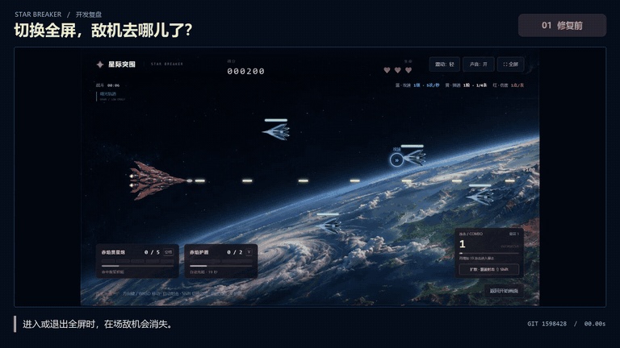

# 我做了个浏览器飞机大战，结果一切全屏敌机就消失了

有一局《星际突围》打到第 8 秒，屏幕上还有三架完整可见的敌机，右边缘也露着一架。我点了一下「全屏」，几架敌机和蓝色补给球一起消失。战斗计时还在走，分数仍是 300。等新一波敌机进来，再点「退出全屏」，战场又被清了一次。

[观看高清对比短片](../media/fullscreen-compare.mp4) · [在线试玩《星际突围》](https://star-breaker-aura-261107.huafeihua560.chatgpt.site/)

前后两段分别录自相邻的 Git 提交 `1598428` 和 `854cd03`。两段都在实战里点击「全屏」和「退出全屏」，画面从 1280 × 720 切到 1707 × 1067，再切回来。

## 为什么只剩自己的战机？

游戏用 Canvas 绘制。浏览器窗口尺寸改变或切换全屏时，都会调用 `resizeBattlefield()` 调整战场。旧版在这个函数里还调用了 `resetEncounter(false)`，也就是执行一次战场重置。[旧版尺寸调整代码](https://github.com/Aura417786/StarCraft/blob/15984286e9dab8aa5d55f4f292a98b78daecf04b/game.js#L136-L164)

这里的 `false` 只控制一部分逻辑，例如是否重置分数和技能。清空敌机列表的 `enemies.length = 0` 和清空补给的 `powerups.length = 0` 在条件判断外面，每次调用都会执行。这就解释了为什么分数、计时都还在，敌机却凭空消失。[旧版重置代码](https://github.com/Aura417786/StarCraft/blob/15984286e9dab8aa5d55f4f292a98b78daecf04b/game.js#L434-L445)

## 我怎么修的

切换全屏现在调用 `resizeEncounter()`。原来的敌机、补给、编队和刷新进度继续用，只把坐标换算到新战场。横向按宽度比例转换，纵向按扣除顶部和底部界面后的可飞区域转换。比如一架敌机原来在可飞区域的一半高度，画面变高后，它仍然在新区域的一半高度，血量也继续沿用。浏览器重复报告同样尺寸时直接返回，过渡时报告零尺寸也会跳过。[修复提交](https://github.com/Aura417786/StarCraft/commit/854cd0308431c1f8f01b2dae0f843e051d51939e)

实际尺寸改变时，已发射的子弹和瞬时爆炸会清理，玩家会获得一小段受伤保护。缩回窗口时，两架战机可能被挤得很近，这段时间留给玩家重新走位。

## 我怎么确认修好了

实机验收时，我会等屏幕里已经有敌机，再进出一次全屏，盯着切换前那几架敌机和它们的血条。自动检查还会确认切换前后的敌机是代码里的同一批对象，血量、编队、运输舰和计时都接得上。用修复后的历史快照重新跑了一次，71 项集成、270 项战斗和 59 项音频检查全部通过。[全屏回归检查](https://github.com/Aura417786/StarCraft/blob/854cd0308431c1f8f01b2dae0f843e051d51939e/work/v13-check.cjs#L509-L539)

这次我记住了一条判断方法。碰到全屏、缩放窗口这种操作，先列出哪些是屏幕尺寸相关的数据，哪些是本局进度。把这两类数据分开处理，之后再做画面适配就容易验证了。

如果这段复盘对你有帮助，欢迎在 GitHub 点个 Star，方便以后找到后续更新。[查看游戏源码](https://github.com/Aura417786/StarCraft)
